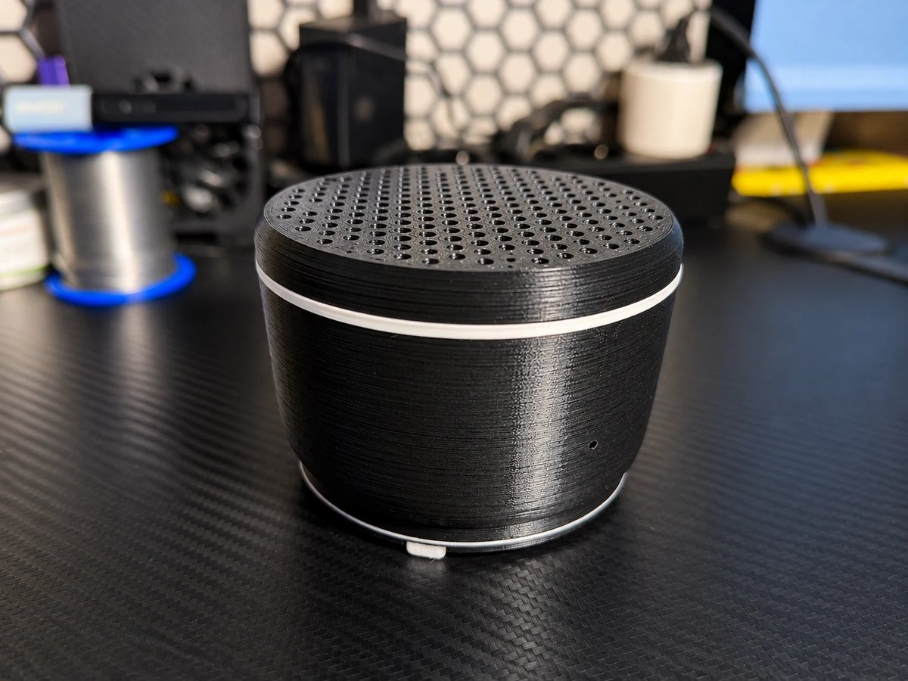
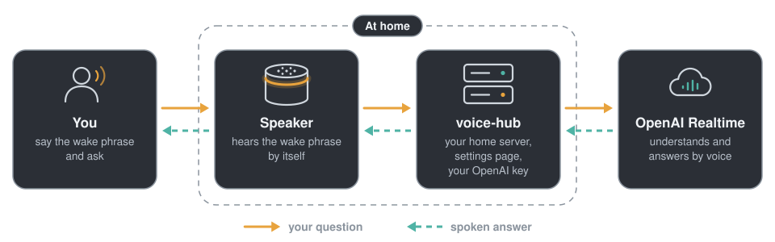

# Pytaichenko

**English** · [Українська](README.uk.md)

  

<b>A voice speaker you build yourself: it hears its wake phrase on the board, and a small server on your home network holds the conversation with the OpenAI Realtime API.</b>

  
  
  

<a href="https://feroxes.github.io/pytaichenko/?lang=en"><b>Step-by-step guide</b></a> · <a href="https://github.com/feroxes/pytaichenko/releases/latest">Latest release</a>

## What it does

- Starts with a wake phrase or a press of the button on top. The phrase is one of three: Hey Jarvis, Okay Nabu or Hey Mycroft, chosen for each speaker on the settings page.
- Answers out loud. After an answer you can keep asking without the phrase.
- “Thank you, that’s all” ends the conversation. The volume changes by voice or with a slider on the settings page.
- A light ring and two short sounds show what the speaker is doing.
- The server's settings page, in Ukrainian and English, holds everything in one place: the password, the OpenAI key, model and voice, the conversation language (Ukrainian or English) and instructions, the timings and the speakers.
- The firmware installs from the browser over USB, and new versions install the same way without erasing the speaker.

## How it works

  

- The speaker recognises the wake phrase on its own board. Until it hears the phrase or you press the button, no sound leaves it.
- Then it sends your voice to `voice-hub`, a small service in Docker on a computer in your home network. The service keeps your OpenAI key, holds the conversation with the OpenAI Realtime API and sends the spoken answer back to the speaker.
- After the answer the speaker listens a few more seconds for a follow-up, then waits for the wake phrase again.

## Build it

The [step-by-step guide](https://feroxes.github.io/pytaichenko/?lang=en) shows everything in pictures: the parts with links, printing, soldering and assembly. Besides the parts you need a 3D printer, a soldering iron, a computer at home that stays on and runs Docker, and an OpenAI API key; conversations are paid at OpenAI prices.

1. [Get the parts](https://feroxes.github.io/pytaichenko/?lang=en#parts) and [print the case](https://feroxes.github.io/pytaichenko/?lang=en#print).
2. [Solder](https://feroxes.github.io/pytaichenko/?lang=en#solder) and [assemble](https://feroxes.github.io/pytaichenko/?lang=en#assembly) the speaker.
3. [Install the firmware](https://feroxes.github.io/pytaichenko/?lang=en#firmware) from the browser over USB.
4. [Start the server](https://feroxes.github.io/pytaichenko/?lang=en#server) and adopt the speaker on its settings page.

If something does not work, see [If something goes wrong](https://feroxes.github.io/pytaichenko/?lang=en#trouble).

## Versions and releases

- The firmware, the server and the site share one version number.
- X.0.0 is a new speaker generation, that is new hardware; the next one will be 2.0.0.
- Every [release](https://github.com/feroxes/pytaichenko/releases) carries the firmware image `pytaichenko-X.Y.Z.factory.bin` and all the case STL files in `pytaichenko-X.Y.Z-stl.zip`.

## License

- The code (firmware configuration, server, site code, scripts and tests) is under the [MIT License](LICENSE).
- The case design (`case/*.scad`), the STL files (`case/stl`), the renders (`site/assets/renders`) and the written guides (the README files and the texts of the site) are under [CC BY-SA 4.0](LICENSE-hardware).
- Third-party parts keep their own licenses: the firmware images include ESPHome code under GPL-3.0 and wake phrase models under Apache-2.0. See [THIRD_PARTY.md](THIRD_PARTY.md).

## Thanks

- [ESPHome](https://esphome.io), for the firmware build system, the voice and wake phrase components and ESP Web Tools, which installs the firmware from the browser.
- The Open Home Foundation, for the [microWakeWord models](https://github.com/esphome/micro-wake-word-models) Hey Jarvis, Okay Nabu and Hey Mycroft.
- The [OpenAI API](https://platform.openai.com), for the conversation in real time (the Realtime API).
