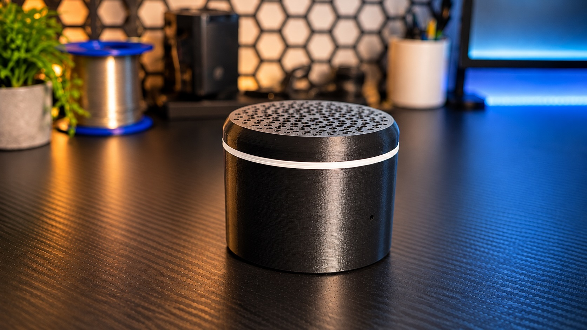
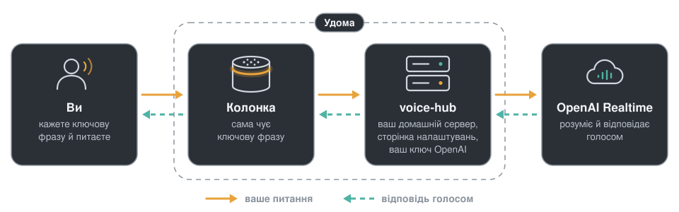

# Питайченко

[English](README.md) · **Українська**

  

<b>Голосова колонка, яку збирають самі: вона чує ключову фразу просто на платі й веде розмову з OpenAI Realtime API або GPT-Live.</b>

  
  
  
  

<a href="https://feroxes.github.io/pytaichenko/?lang=uk&v=2"><b>Покрокова інструкція</b></a> · <a href="https://github.com/feroxes/pytaichenko/releases/latest">Останній випуск</a>

Колонка має дві версії, кожна зі своїм залізом і своїми сторінками інструкції.

**Версія 2** сама розмовляє з OpenAI. Вона зібрана на платі ESP32-S3, а сторінку налаштувань показує сама колонка. [Інструкція до версії 2](https://feroxes.github.io/pytaichenko/?lang=uk&v=2)

**Версія 1** потребує невеликого домашнього сервера: розмову веде служба `voice-hub` у Docker, вона ж показує сторінку налаштувань. Версія зібрана на платі ESP32. [Інструкція до версії 1](https://feroxes.github.io/pytaichenko/?lang=uk&v=1)

## Що вміє

- Вмикається ключовою фразою або натиском кнопки зверху. Фраза — одна з трьох: Hey Jarvis, Okay Nabu або Hey Mycroft; її обирають для кожної колонки на сторінці налаштувань.
- Відповідає голосом. Після відповіді можна питати далі без фрази.
- «Дякую, все» завершує розмову. Гучність змінюється голосом або повзунком на сторінці налаштувань.
- Кільце світла й два короткі сигнали показують, що робить колонка.
- На сторінці налаштувань, українською й англійською, задають ключ OpenAI, модель, голос, інструкції, мову розмови, часи й ключову фразу. У версії 2 цю сторінку показує сама колонка. У версії 1 це сторінка сервера, і на ній ще є список колонок.
- Прошивку ставлять з браузера через USB. Далі версія 2 оновлюється зі сторінки налаштувань, без кабелю; у версії 1 нові версії ставляться з браузера так само, без стирання колонки.

## Як це працює

  

- В обох версіях колонка розпізнає ключову фразу на власній платі. Доки вона не почула фразу або ви не натиснули кнопку, жоден звук із неї нікуди не йде.
- Далі версія 2 надсилає ваш голос просто в OpenAI Realtime API або GPT-Live, як ви оберете на її сторінці налаштувань. Колонка зберігає ваш ключ OpenAI і сама відтворює відповідь голосом.
- Версія 1, як на малюнку, надсилає ваш голос службі `voice-hub` — невеликому серверу в Docker на комп'ютері у вашій домашній мережі. Служба зберігає ваш ключ OpenAI, веде розмову з OpenAI Realtime API й повертає колонці відповідь голосом.
- Після відповіді колонка ще кілька секунд слухає продовження, а потім знову чекає ключову фразу.

## Як зібрати

Покрокова інструкція показує все з малюнками для кожної версії: деталі з посиланнями, друк, пайку й збирання. Крім деталей, знадобляться 3D-принтер, паяльник, Wi-Fi на 2,4 ГГц і ключ OpenAI API; розмови оплачуються за цінами OpenAI. Для версії 1 потрібен ще комп'ютер удома, що працює постійно й має Docker.

**Версія 2**

1. [Придбайте деталі](https://feroxes.github.io/pytaichenko/?lang=uk&v=2#parts) й [надрукуйте корпус](https://feroxes.github.io/pytaichenko/?lang=uk&v=2#print).
2. [Спаяйте](https://feroxes.github.io/pytaichenko/?lang=uk&v=2#solder) й [зберіть](https://feroxes.github.io/pytaichenko/?lang=uk&v=2#assembly) колонку.
3. [Встановіть прошивку](https://feroxes.github.io/pytaichenko/?lang=uk&v=2#firmware) з браузера через USB, потім відкрийте сторінку налаштувань колонки й впишіть ключ OpenAI.

**Версія 1**

1. [Придбайте деталі](https://feroxes.github.io/pytaichenko/?lang=uk&v=1#parts) й [надрукуйте корпус](https://feroxes.github.io/pytaichenko/?lang=uk&v=1#print).
2. [Спаяйте](https://feroxes.github.io/pytaichenko/?lang=uk&v=1#solder) й [зберіть](https://feroxes.github.io/pytaichenko/?lang=uk&v=1#assembly) колонку.
3. [Встановіть прошивку](https://feroxes.github.io/pytaichenko/?lang=uk&v=1#firmware) з браузера через USB.
4. [Запустіть сервер](https://feroxes.github.io/pytaichenko/?lang=uk&v=1#server) і заберіть колонку на його сторінці налаштувань.

Якщо щось не працює, загляньте в розділ «Якщо щось не так» для [версії 2](https://feroxes.github.io/pytaichenko/?lang=uk&v=2#trouble) або [версії 1](https://feroxes.github.io/pytaichenko/?lang=uk&v=1#trouble).

## Версії й випуски

- X.0.0 — нове покоління колонки, тобто нове залізо: версія 1 виходить як `v1.x.y`, версія 2 — як `v2.x.y`, починаючи з 2.0.0.
- Кожна версія має власний номер. У версії 1 він спільний для прошивки й сервера, у версії 2 це номер прошивки.
- Кожен [випуск](https://github.com/feroxes/pytaichenko/releases) версії 1 містить образ прошивки `pytaichenko-1.Y.Z.factory.bin` і всі STL-файли корпусу в `pytaichenko-1.Y.Z-stl.zip`.
- Кожен випуск версії 2 містить образ прошивки `pytaichenko-2.Y.Z.factory.bin` для першого встановлення через USB, оновлення `pytaichenko-2.Y.Z.ota.bin`, яке колонка ставить зі сторінки налаштувань, і всі STL-файли корпусу в `pytaichenko-2.Y.Z-stl.zip`.
- Значок і посилання «Останній випуск» показують найновіший випуск версії 2; випуски версії 1 лишаються на сторінці випусків. Сайт завжди пропонує найновіший випуск кожної версії.

## Ліцензія

- Код (прошивка версії 2, конфігурація прошивки й сервер версії 1, код сайту, скрипти й тести) поширюється за [ліцензією MIT](LICENSE).
- Модель корпусу (`v1/case/*.scad`, `v2/case/*.scad`), STL-файли (`v1/case/stl`, `v2/case/stl`), малюнки (`site/assets/renders`) і тексти інструкцій (файли README й тексти сайту) поширюються за [CC BY-SA 4.0](LICENSE-hardware).
- Сторонні частини мають власні ліцензії: образи прошивки версії 1 містять код ESPHome під GPL-3.0; образи версії 2 зібрано на ESP-IDF від Espressif і компонентах під Apache-2.0, MIT та Espressif MIT License; обидві містять моделі ключових фраз під Apache-2.0. Див. [THIRD_PARTY.md](THIRD_PARTY.md).

## Подяки

- [Espressif](https://www.espressif.com) — за [ESP-IDF](https://github.com/espressif/esp-idf) і компоненти, на яких зібрано прошивку версії 2, серед них esp-sr, що очищує звук двох мікрофонів, і esp-tflite-micro, що запускає моделі ключових фраз.
- [ESPHome](https://esphome.io) — за систему збирання прошивки версії 1, її компоненти голосу й ключових фраз та ESP Web Tools, що ставить прошивку обох версій з браузера.
- Open Home Foundation — за [моделі microWakeWord](https://github.com/esphome/micro-wake-word-models) Hey Jarvis, Okay Nabu і Hey Mycroft.
- [OpenAI API](https://platform.openai.com) — за розмову в реальному часі (Realtime API або GPT-Live).
